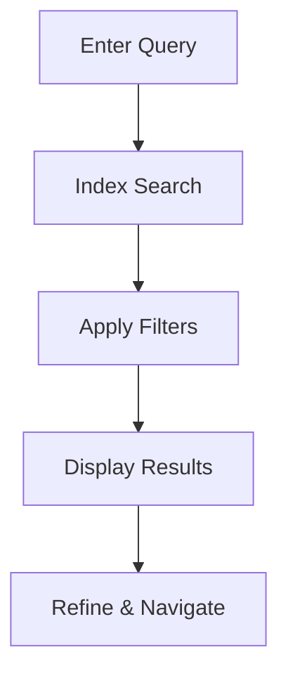

## Overview

Claim Clarity provides powerful tools to manage your project documentation efficiently. You can organize content, track changes, collaborate with teams, and find information quickly. These core features ensure your docs stay current and accessible.

<Callout kind="tip">
Start by creating your first document to experience these features in action.
</Callout>

## Key Features

Discover the main capabilities through these feature cards.

<Columns cols={2}>
  <Card title="Document Organization" icon="folder" href="#document-organization">
    Structure your docs with folders and tags for easy navigation.
  </Card>
  <Card title="Version Control" icon="git-branch" href="#version-control">
    Track edits and revert changes with built-in version history.
  </Card>
  <Card title="Collaboration" icon="users" href="#collaboration">
    Share docs securely and work together in real-time.
  </Card>
  <Card title="Search and Filtering" icon="search" href="#search">
    Quickly locate content using advanced search tools.
  </Card>
</Columns>

## Document Organization and Tagging

Organize your documentation hierarchically with folders and apply tags for categorization. This keeps large projects manageable.

### How to Organize Documents

<Steps>
  <Step title="Create Folders" icon="folder-plus">
    Navigate to the workspace dashboard and select `New Folder`. Name it descriptively, like `API Reference`.
  </Step>
  <Step title="Add Tags" icon="tag">
    Open a document, click the tags icon, and enter labels such as `api`, `internal`, or `draft`.
  </Step>
  <Step title="Rearrange" icon="move">
    Drag and drop documents between folders to restructure your hierarchy.
  </Step>
</Steps>

Use tags to filter views dynamically.

## Version Control and Editing Tools

Claim Clarity offers robust version control similar to Git, integrated with a rich text editor.

<Tabs>
  <Tab title="Rich Text Editor" icon="edit-3">
    Write docs with markdown support, embeds, and syntax highlighting.

````markdown
# Sample Document

## API Endpoint

```javascript
const response = await fetch('https://api.example.com/v1/docs', {
  headers: { 'Authorization': `Bearer ${YOUR_API_KEY}` }
});
```
````
  </Tab>
  <Tab title="Version History" icon="clock">
    View changes over time and restore previous versions.

    <Expandable title="Advanced Diff View" default-open="false">
      Compare versions side-by-side to spot exact changes.
    </Expandable>
  </Tab>
</Tabs>

## Collaboration and Sharing Options

Invite team members and control access levels.

| Role | Permissions | Use Case |
|------|-------------|----------|
| Viewer | Read-only | Clients, stakeholders |
| Editor | Edit content | Team contributors |
| Admin | Full access | Project leads |

<Callout kind="alert">
Always review sharing settings before publishing sensitive docs.
</Callout>

Share via public links or embed codes:

```html
<iframe src="https://claimclarity.ai/embed/doc/12345" width="100%" height="600"></iframe>
```

## Search and Filtering Capabilities

Find exactly what you need with full-text search and filters.

<CodeGroup tabs="Basic,Advanced">
  ```javascript
  // Search query example
  searchDocs("authentication API");
  ```
  ```javascript
  // Filtered search
  searchDocs("authentication", {
    tags: ["api", "internal"],
    folder: "reference"
  });
  ```
</CodeGroup>

Combine filters for precise results, such as `tag:api AND updated>2024-01-01`.



## Next Steps

<Columns cols={3}>
  <Card title="Quickstart" icon="rocket" href="/quickstart">
    Set up your first workspace.
  </Card>
  <Card title="Authentication" icon="shield" href="/authentication">
    Secure your account.
  </Card>
  <Card title="API Reference" icon="code" href="/api">
    Integrate programmatically.
  </Card>
</Columns>