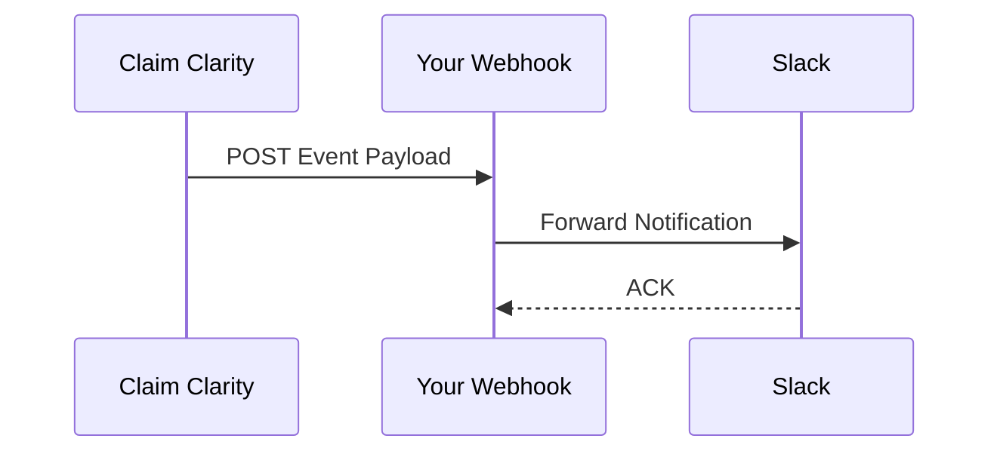

## Overview

Connect Claim Clarity to your favorite tools to automate workflows, sync documentation, and receive real-time updates. Use the API for custom integrations or webhooks for event-driven notifications.

<Callout kind="info">
Review your API limits and permissions before setting up integrations.
</Callout>

## Setting Up API Access

Generate an API key from your dashboard to access Claim Clarity endpoints.

<Steps>
  <Step title="Navigate to Settings" icon="settings">
    Log in to `https://dashboard.example.com` and go to **Account > API Keys**.
  </Step>
  <Step title="Create Key" icon="key">
    Click **Generate New Key** and select scopes like `read:docs` or `write:docs`.
  </Step>
  <Step title="Copy and Secure" icon="copy">
    Copy the generated key and store it securely. Do not share it publicly.
  </Step>
</Steps>

Use the key in requests:

<CodeGroup tabs="JavaScript,cURL">
  ```javascript
  const response = await fetch('https://api.example.com/v1/docs', {
    headers: {
      'Authorization': `Bearer YOUR_API_KEY`,
      'Content-Type': 'application/json'
    }
  });
  const docs = await response.json();
  console.log(docs);
  ```
  ```bash
  curl -H "Authorization: Bearer YOUR_API_KEY" \
       -H "Content-Type: application/json" \
       https://api.example.com/v1/docs
  ```
</CodeGroup>

<ParamField header="Authorization" param-type="string" required="true">
  Bearer token: `Bearer YOUR_API_KEY`
</ParamField>

<ParamField query="page" param-type="integer" required="false">
  Page number for pagination, starting at 1.
</ParamField>

## Popular Integrations

Explore ready-to-use connections.

<Columns cols={2}>
  <Card title="Slack Notifications" icon="message-circle" href="https://slack.com/apps" target="_blank">
    Receive alerts for document updates and approvals.
  </Card>
  <Card title="Google Drive Sync" icon="file-text" href="https://drive.google.com" target="_blank">
    Automatically sync your Claim Clarity docs with Drive folders.
  </Card>
  <Card title="Zapier" icon="zap" href="https://zapier.com" target="_blank">
    No-code automations with 5000+ apps.
  </Card>
  <Card title="GitHub" icon="github" href="https://github.com" target="_blank">
    Push documentation changes to repositories.
  </Card>
</Columns>

## Webhook Configurations

Set up webhooks to listen for events like document creation or updates.

### Basic Setup

<Steps>
  <Step title="Create Webhook" icon="link">
    In dashboard, go to **Integrations > Webhooks > New Webhook**.
  </Step>
  <Step title="Configure URL" icon="globe">
    Enter your endpoint: `https://your-webhook-url.com/webhook`.
  </Step>
  <Step title="Select Events" icon="bell">
    Choose events: `doc.created`, `doc.updated`, `doc.approved`.
  </Step>
</Steps>

Example incoming payload:

```json
{
  "event": "doc.updated",
  "data": {
    "id": "doc_123abc",
    "title": "API Reference",
    "updated_at": "2024-10-15T10:30:00Z"
  }
}
```

## Custom Integrations with Tabs

Customize for specific platforms.

<Tabs>
  <Tab title="Slack Custom" icon="message-circle">
    Use this payload template for Slack:

````json
{
  "text": "Document *`{data.title}`* was updated.",
  "channel": "#docs"
}
````
  </Tab>
  <Tab title="Email via SendGrid" icon="mail">
    Integrate with SendGrid:

````javascript
const sgMail = require('@sendgrid/mail');
sgMail.setApiKey('YOUR_SENDGRID_KEY');

const msg = {
  to: 'user@example.com',
  subject: `Doc Updated: ${payload.data.title}`,
  text: 'Check the latest changes.'
};
sgMail.send(msg);
````
  </Tab>
</Tabs>



## Troubleshooting

<ExpandableGroup>
  <Expandable title="Webhook Not Triggering" default-open="true">
    - Verify your webhook URL is publicly accessible (use ngrok for local testing).
    - Check event scopes in dashboard.
    - Review recent deliveries log for errors.
  </Expandable>
  <Expandable title="401 Unauthorized Errors">
    Regenerate your API key and ensure `Bearer` prefix.
    
    Common header:
    ```
    Authorization: Bearer YOUR_API_KEY
    ```
  </Expandable>
  <Expandable title="Timeout Issues">
    Increase your endpoint timeout to `>30s`. Claim Clarity retries failed deliveries 3 times.
  </Expandable>
</ExpandableGroup>

<Callout kind="tip">
Test integrations in a staging environment first. Monitor logs at `https://dashboard.example.com/integrations/logs`.
</Callout>